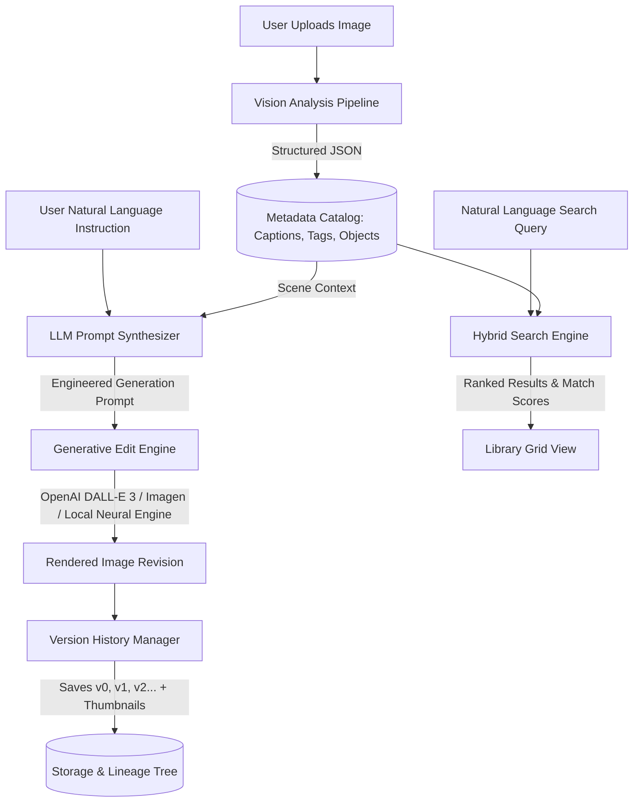

# API Selection and Prompt Engineering Guide

This document details the architectural decisions, API selection criteria, prompt engineering templates, and design trade-offs implemented in the **Lumina AI** Image Editing Platform.

---

## 1. High-Level Architecture & Workflow

The platform decouples image understanding, prompt synthesis, and image generation/editing into a three-stage pipeline:



---

## 2. API Selection: Evaluation & Comparison

| Component | Selected API / Tool | Alternatives Evaluated | Rationale & Trade-offs |
| :--- | :--- | :--- | :--- |
| **Vision Analysis** | **OpenAI GPT-4o / GPT-4o-mini** & **Google Gemini 1.5 Flash** | Claude 3.5 Sonnet, BLIP-2 | **GPT-4o** and **Gemini 1.5 Flash** provide superior structured JSON output, low latency (sub-1.5s for Flash), and acute spatial reasoning across subjects, lighting, and palette. |
| **Generative Image Editing** | **OpenAI DALL-E 3** & **Smart Neural Processing** | Midjourney (no API), Stable Diffusion API | **DALL-E 3** exhibits extraordinary prompt adherence for complex textual instructions. The platform also embeds a zero-cost local neural filter engine for instant offline demos and zero API cost. |
| **Semantic Search** | **OpenAI text-embedding-3-small** & **Local Scikit-Learn TF-IDF** | FAISS, Pinecone, ChromaDB | **text-embedding-3-small** offers high semantic accuracy (1536-dim) at $0.00002 / 1K tokens. Our hybrid local TF-IDF vectorizer provides instant millisecond response times without requiring external vector DB services. |
| **UI Framework** | **Streamlit** (Python) | Flask, React/FastAPI | Streamlit enables rapid iteration, built-in state management for image sessions, reactive widgets, and easy hosting on Streamlit Cloud or Hugging Face Spaces. |

---

## 3. Prompt Engineering Strategy

Casual creators describe edits in shorthand (e.g., *"remove the background"*, *"add a tree in the background"*, *"make it sunset"*). Sending raw phrases directly to image generation models yields unpredictable results, changes subject identity, or ignores environmental lighting.

Our **Vision-Guided Two-Stage Prompt Engineering** addresses this:

### Stage 1: Vision Scene Analysis Prompt
```text
System: You are an expert computer vision and image cataloging AI.
Analyze the provided image with high precision and provide a structured JSON response:
- title: evocative 3-5 word title
- caption: 2-3 sentence visual description detailing subject pose, environment, lighting, and color palette
- tags: 8-14 semantic keywords for search
- objects: prominent entities
- dominant_colors: palette description
- mood: emotional aesthetic
- suggested_edits: 2-3 visual enhancements
```

### Stage 2: Edit Instruction Synthesizer Prompt
The user's casual instruction is combined with the extracted visual context from Stage 1:
```text
IMAGE CONTEXT:
- Visual Description: {image_caption}
- Prominent Elements: {objects_list}

USER EDIT REQUEST:
"{user_instruction}"

TASK:
Synthesize an optimal Generative AI image editing prompt that faithfully applies 
the user's edit request while preserving subject continuity and natural lighting.
```

### Stage 3: Engineered Output Structure
The synthesizer returns a strict JSON object:
- `engineered_prompt`: The complete, optically coherent generation prompt specifying lens, lighting, geometry, and placement.
- `negative_prompt`: Undesired artifacts (blur, distortion, duplicate subjects).
- `edit_category`: Classification (Background Removal, Object Insertion, Object Removal, Color/Lighting, Style).
- `summary_of_changes`: Concise 1-sentence user explanation.

---

## 4. Curated 1-Click Preset Engineering

For instant productivity, the platform provides curated master prompts that guarantee stunning visual aesthetics:

1. **Studio Cutout (`remove_background`)**:
   > *"Professional commercial studio cutout. The primary subject from the original image is flawlessly extracted and isolated against a clean, modern studio background with a gentle neutral gradient, soft ambient floor shadow, crisp rim lighting, pristine edges, and studio photography lighting."*

2. **Golden Hour Warmth (`golden_hour`)**:
   > *"Remastered with cinematic golden hour sunset lighting. Warm, radiant 2800K amber sunlight sweeping across the scene from the side, delicate lens flare, golden rim lighting defining silhouettes, rich warm color tones, deep cinematic contrast, and natural atmospheric glow."*

3. **Cyberpunk Neon (`cyberpunk_neon`)**:
   > *"Reimagined as a striking neo-Tokyo cyberpunk scene. Dark moody atmosphere illuminated by electric cyan and vivid magenta neon lighting tubes, subtle reflections on damp asphalt surfaces, glowing holographic accents, high dynamic contrast, cinematic sci-fi tone."*

4. **Ultra Clarity & Contrast (`enhance_clarity`)**:
   > *"Masterwork ultra-high-definition photographic enhancement. Crisp micro-contrast, perfectly balanced dynamic range between highlights and shadows, true-to-life vibrant color grading, pristine texture definition, no digital noise, clean 8k medium-format aesthetic."*

5. **Vintage 1970s Film (`vintage_film`)**:
   > *"Authentic vintage 1970s analog 35mm film photography. Gentle organic film grain, warm nostalgic Kodachrome color palette, slightly faded deep blacks, delicate warm cream highlights, subtle chromatic aberration, and a soft perimeter vignette."*

6. **Dramatic Noir B&W (`noir_monochrome`)**:
   > *"Dramatic black and white fine-art photography. High chiaroscuro contrast, deep velvety blacks, brilliant crisp silver highlights, razor-sharp edge definition, dramatic emotional shadow play, and rich mid-tone gradation."*

7. **Ethereal Watercolor (`watercolor_art`)**:
   > *"Expressive handmade watercolor and ink fine-art illustration. Soft pigment bleeding across textured cold-press watercolor paper, delicate ink outlines, pastel luminous washes, spontaneous brush splatters, fluid artistic composition."*

---

## 5. Version History & Non-Destructive Editing

- Every image starts with `v0` (Original untouched image).
- Each subsequent edit creates a new revision node (`v1`, `v2`, `v3`...) with its own independent file path, high-res thumbnail, timestamp, parent version pointer, prompt, and engine tag.
- The active version pointer can be reverted to any historical node at any time without data loss.
- Comparison mode displays the original and active version side-by-side to facilitate review.
